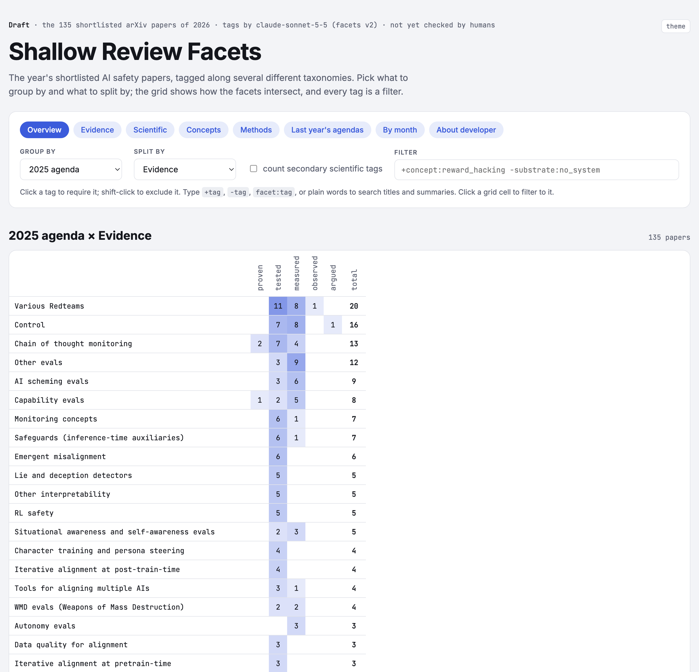
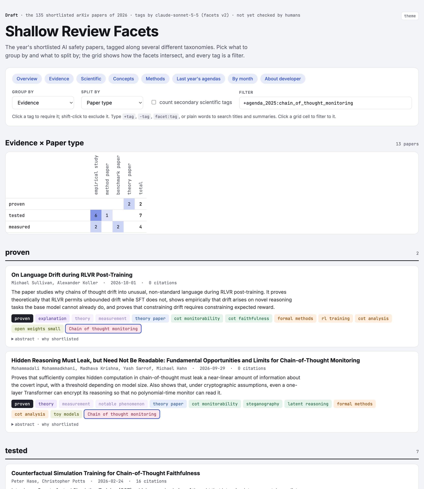

# Taxonomy

Tags the 2026 shortlisted papers along several facets with Claude Sonnet 5.5, and builds a static site for
browsing them: group by one facet, split by another, and filter by any tag.

The grid shows how two facets intersect, here 2025 agenda × Evidence:



Below the grid, each group lists its papers with Claude's summary and their tags, colour-coded by facet. Clicking a
tag filters to it; here the papers are filtered to the Chain of thought monitoring agenda:



## Layout

- `input/` – everything the scripts read, copied in from elsewhere in the repo (re-copy to update):
  - `arxiv-papers-shortlisted.csv` – the combined 2026 arXiv shortlist (Jan–Oct), from
    `scraping-scripts/arxiv-scraper/results/shortlisted/2026/arxiv-papers-shortlisted.csv`.
  - `taxonomy-2025.yaml` – last year's agendas, from `main-pipeline/data/taxonomy-2025.yaml`.
- `facets.yaml` – the facets and their allowed tags (evidence, scientific contribution, paper type, concept,
  method). Bump `version` after editing it so the papers get retagged.
- `src/tag_papers.py` – sends each paper to Claude, which tags it against `facets.yaml` and the 2025 agendas.
  Writes `output/tags.jsonl`.
- `src/export_csv.py` – writes `output/arxiv-papers-tagged.csv`: the input CSV plus Claude's summary, one column
  per facet (tags separated by `; `), `new_agenda`, and a `tags` column with every tag.
- `src/build_site.py` – joins the papers with their tags into `site/data.js`.
- `examples/tagging-example.md` – one full tagging request for a single paper: the system prompt, user message,
  output schema and Claude's structured output.
- `site/index.html` – the browsing site.
- `images/` – screenshots of the site for this README.

## Usage

From this folder, with `ANTHROPIC_API_KEY` set in `taxonomy/.env` (gitignored):

```bash
uv run python src/tag_papers.py      # tag new papers (--limit N to try a few, --overwrite to retag all)
uv run python src/export_csv.py      # write output/arxiv-papers-tagged.csv
uv run python src/build_site.py      # rebuild site/data.js
python3 -m http.server 8765 --directory site   # then open http://localhost:8765
```

When no 2025 agenda fits a paper, Claude proposes a new one, which shows up as `new 2026: <name>` under the
2025 agenda facet.

## Deployment

The site is static files only, so any static host works; these steps use Netlify. Netlify only serves the files in
`site/` and never runs the Python scripts, so always run `src/build_site.py` before deploying.

### Deploying from the command line

Install the [Netlify CLI](https://docs.netlify.com/cli/get-started/) once, and sign in (opens the browser once):

```bash
npm install -g netlify-cli
netlify login
```

From this folder, either create a new Netlify project or link to an existing one. Both write
`.netlify/state.json`, which is gitignored:

```bash
netlify sites:create --name <project-name>   # new project, served at https://<project-name>.netlify.app
netlify link --id <project-id>               # existing project (the id is under Project configuration)
```

Then deploy. `--dir site` uploads only the site folder, so no `.env` file is ever sent:

```bash
netlify deploy --dir site          # draft deploy with its own preview URL, to check first
netlify deploy --prod --dir site   # publish to the project's main URL
```

To deploy without a browser (e.g. from a script), create a personal access token in Netlify under
User settings → Applications → Personal access tokens and set it in the shell instead of running `netlify login`.
Treat it like a password: never commit it.

```bash
export NETLIFY_AUTH_TOKEN=<your token>
netlify deploy --prod --dir site --site <project-id>
```

### Redeploying automatically on push

The repo-root `netlify.toml` tells Netlify to publish `taxonomy/site` with no build command. Once `netlify.toml`
and `taxonomy/site/` are on the default branch on GitHub, connect the repo by running this from the repo root (it
may open the browser to authorize GitHub the first time):

```bash
netlify init
```

Or in the dashboard: Project configuration → Build & deploy → Continuous deployment → Link repository, with the
default branch and publish directory `taxonomy/site`. After that, every push to that branch redeploys the site and
every pull request gets a `deploy-preview-<n>--<project-name>.netlify.app` link. Merging publishes immediately, so
use a pull request to preview retagged data before it goes live.
